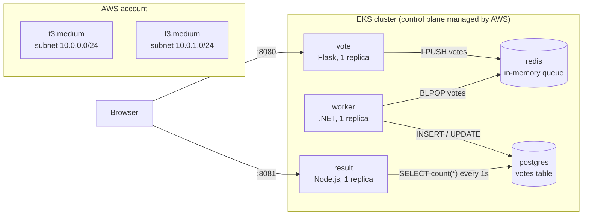

# Voting App on Amazon EKS

This is my fork of [dockersamples/example-voting-app](https://github.com/dockersamples/example-voting-app), turned into the Capstone 1 project.

The application code is not mine. Everything around it is: the AWS network, the cluster and node group, the IAM roles, the container hardening, the build pipeline, and the Helm chart that releases the app.

## What's in here

| Path | What it is |
|---|---|
| `vote/` | Python/Flask frontend. One vote per browser session |
| `result/` | Node.js results page, updates over websockets |
| `worker/` | .NET consumer. Moves votes from Redis into Postgres |
| `terraform/` | VPC, subnets, IAM, EKS cluster, managed node group |
| `helm-charts/voting-app/` | The chart that deploys all five components |
| `.github/workflows/` | Three pipelines: `vote-ci`, `result-ci`, `worker-ci` |
| `k8s-specifications/` | Plain manifests from upstream. Kept for reference, superseded by the chart |
| `docs/` | Troubleshooting log, rollback evidence, screenshots |

## Capstone requirements

| Requirement | Where it is |
|---|---|
| Forked repo with a clear README | This file |
| Terraform code for the cluster | `terraform/`, applied twice from scratch |
| One Helm chart | `helm-charts/voting-app/` |
| Working pipeline that builds and scans | `.github/workflows/`, Trivy as a gate |
| Architecture diagram | The Mermaid diagram below |
| Environment rebuilds from code | `docs/evidence.md` section 1 |
| No secrets in Git | `docs/evidence.md` section 5 |
| Rollback shown live | `docs/evidence.md` section 4 |
| One push builds, scans **and deploys** | Not met. The build and scan are automated; deployment is a manual `helm upgrade`. See [Known gaps](#known-gaps) |

## Architecture



The data flow in one line: `vote` pushes a JSON vote onto a Redis list, `worker` pops it and writes a row into Postgres, `result` polls Postgres once per second and pushes the totals to the browser over socket.io.

Both web services are `NodePort` (`31000`, `31001`). There is no load balancer, and the node security group only allows `30000-32767` from inside the VPC, so from outside I reach them with `kubectl port-forward`. An ALB without an Ingress controller and TLS would be a security group with extra steps. See [Known gaps](#known-gaps).

## Infrastructure

`terraform/` is flat, four files, no modules. At this size modules would add indirection without removing any duplication.

| Resource | Note |
|---|---|
| VPC `10.0.0.0/16` | `enable_dns_hostnames` is required for node registration |
| 2 public subnets, 2 AZs | Tagged `kubernetes.io/role/elb=1` so a load balancer can find them later. ELBs also require subnets in at least two AZs |
| Internet gateway + route table | No NAT gateway. Public subnets keep the cost down, and every node gets a public IP |
| IAM role `eks_cluster` | Trusted by `eks.amazonaws.com`, carries `AmazonEKSClusterPolicy` |
| IAM role `eks_node` | Trusted by `ec2.amazonaws.com`, carries worker, CNI, ECR and SSM policies |
| `aws_eks_cluster` | Kubernetes 1.37, control plane logs enabled (api, audit, authenticator, controllerManager, scheduler) |
| Launch template | Attaches both my node security group and the EKS cluster security group |
| `aws_eks_node_group` | `AL2023_x86_64_STANDARD`, 2 × `t3.medium`, min 1 / max 3 |

Security group on the nodes: inbound `30000-32767/tcp` from the VPC only, all outbound. No SSH. Shell access is through SSM Session Manager, which needs no inbound port at all.

State is local and gitignored. `.terraform.lock.hcl` is committed so the provider version is pinned. Moving state to S3 with DynamoDB locking is the next step, not done here.

## Running it

### Locally

```shell
docker compose up --build
```

Vote at http://localhost:8080, results at http://localhost:8081.

### On AWS

Prerequisites: Terraform, AWS CLI v2 with a working profile, kubectl, Helm.

```shell
cd terraform
terraform apply
```

Takes roughly 12-15 minutes. The node group is the slow part: EC2 launch, node bootstrap, CNI, then registration.

```shell
aws eks update-kubeconfig --name example-voting-app --region us-east-1
kubectl get nodes
```

Images come from GHCR and are tagged by commit SHA, never `latest`. Deploy the SHA that all three workflows built from the same commit:

```shell
helm install voting-app helm-charts/voting-app \
  --set imageTag=<commit-sha> \
  --wait --atomic --timeout 5m
```

Check it:

```shell
kubectl get pods
kubectl port-forward svc/vote 8080:8080
kubectl port-forward svc/result 8081:8081
```

Tear it down when you're not using it. The control plane alone is about $0.10/hour.

```shell
helm uninstall voting-app
cd terraform
terraform destroy
```

## Pipeline

Three workflows, one per service, each triggered only when its own directory changes.

| Stage | What it does |
|---|---|
| Test | Syntax check in the same runtime version the image uses. `python -m compileall`, `node --check`, `dotnet build` |
| Build | Builds with BuildKit and pushes to `ghcr.io/snr-roko/example-voting-app-<service>:<commit-sha>` |
| Scan | Trivy, `CRITICAL,HIGH`, fails the run, ignores findings with no fix available |

The build job depends on the test job, so a broken commit never produces an image.

Tags are commit SHAs on purpose. `latest` is a pointer, not a version: it tells you nothing about what is deployed and gives you nothing to roll back to. With SHAs, `kubectl describe pod` and `helm history` both point at a specific commit.

The scan is a gate, not a report. It failed my first three builds, and fixing it properly is written up in [docs/troubleshooting.md](docs/troubleshooting.md).

## Helm chart

Five Deployments, three Services. `worker` has no Service because nothing connects to it.

```shell
helm template voting-app helm-charts/voting-app   # render locally, no cluster needed
helm install   voting-app helm-charts/voting-app --set imageTag=<sha> --wait --atomic
helm upgrade   voting-app helm-charts/voting-app --set imageTag=<sha> --wait --atomic
helm history   voting-app
helm rollback  voting-app <revision>
```

Every install, upgrade and rollback creates a numbered revision. Helm stores the rendered manifests for each revision as a Secret in the namespace, so a rollback reapplies the exact YAML from that point in time. It does not need the old values file or the old git commit.

`--wait --atomic` is not optional. Without them Helm reports `STATUS: deployed` as soon as the API server accepts the objects, which means a release whose pods are in `ImagePullBackOff` counts as a success. Helm 4 deprecated `--atomic` in favour of `--rollback-on-failure`; the commands above still work on both.

The rollback drill and its output are in [docs/evidence.md](docs/evidence.md).

## Security work

- Both web images run as a non-root user. `vote` runs gunicorn, not the Flask dev server.
- `pip`, `setuptools` and `wheel` are removed from the vote image, and `npm` is removed from the result image. Package managers belong in a build stage, not in a runtime container, and they were the source of most of the vulnerability findings.
- `.NET 7` and `Node 18` were both end-of-life, so both images ran Debian releases that no longer received security updates. Now .NET 10 and Node 24.
- The node security group has no SSH. Use `aws ssm start-session --target <instance-id>`.
- `worker` depends on Npgsql 8 and recent Redis client packages. The original 2021 versions carried a critical RCE.
- No credentials in Git. The pipelines use the automatic `GITHUB_TOKEN`; the GHCR packages are public so nodes can pull without a pull secret.
- `terraform.tfstate` is gitignored. It contains resource attributes in plaintext.

## Known gaps

- No Ingress, no TLS, no DNS. NodePort plus port-forward only.
- No persistence. `redis` and `db` use `emptyDir`, so a pod restart loses queued and stored votes. A `StatefulSet` with EBS volumes is the fix.
- `POSTGRES_PASSWORD` is a plain value in the chart. It should be an External Secret or a Sealed Secret.
- No HPA, no requests/limits on most containers, so scheduling is best-effort.
- Terraform state is local, which makes the project single-user.
- The pipeline builds and scans; deployment is still a manual `helm upgrade`. Closing that gap needs an OIDC-trust role for GitHub Actions and a deploy job, instead of long-lived AWS keys in repository secrets.

## Troubleshooting

What broke, and what fixed it: [docs/troubleshooting.md](docs/troubleshooting.md).
