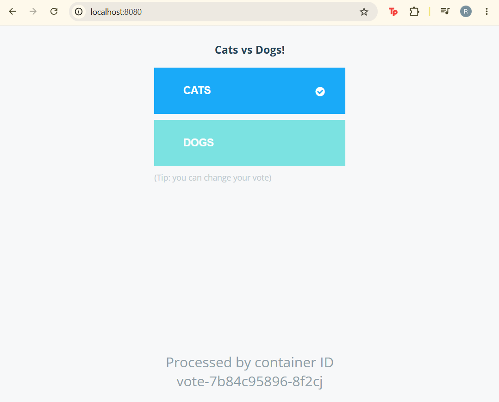
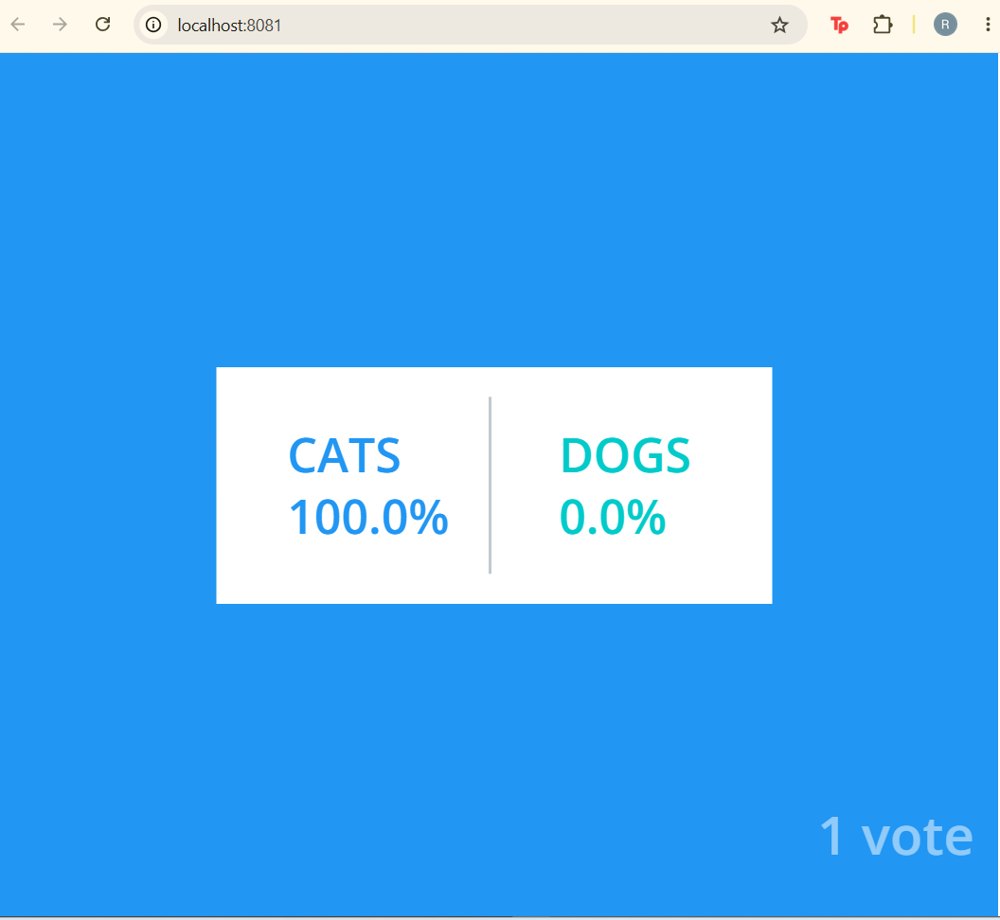

# Evidence

Each section is a command and the output it produced.

## 1. Environment rebuilds from code

The cluster was built, torn down to stop the hourly charge, then rebuilt from the same Terraform code with no manual steps.

```shell
cd terraform
terraform apply
```

```
Apply complete! Resources: 18 added, 0 changed, 0 destroyed.

Outputs:

cluster_endpoint = "https://B1FAADB00E52FF0133AABB2A8359C7A1.gr7.us-east-1.eks.amazonaws.com"
cluster_name = "example-voting-app"
connection_info = {
  "cluster_endpoint" = "https://B1FAADB00E52FF0133AABB2A8359C7A1.gr7.us-east-1.eks.amazonaws.com"
  "cluster_name" = "example-voting-app"
  "node_group" = "example-voting-app-node-group"
  "region" = "us-east-1"
  "vpc_id" = "vpc-058a08de831f7b32a"
}
node_group_name = "example-voting-app-node-group"
vpc_id = "vpc-058a08de831f7b32a"
```

The endpoint changed between builds, which is why the kubeconfig has to be regenerated each time:

```shell
aws eks update-kubeconfig --name example-voting-app --region us-east-1
kubectl get nodes -o wide
```

```
NAME                         STATUS   ROLES    AGE   VERSION
ip-10-0-0-222.ec2.internal   Ready    <none>   32m   v1.37.1-eks-577a51e
ip-10-0-1-41.ec2.internal    Ready    <none>   32m   v1.37.1-eks-577a51e
```

Both nodes are in different subnets (`10.0.0.0/24` and `10.0.1.0/24`), which is what the node group is supposed to do.

Apply to all-nodes-Ready: roughly 12-15 minutes. The control plane reaches `ACTIVE` well before the node group finishes bootstrapping, and the `AGE` column above includes idle time between the apply and this check.

## 2. One commit, three builds, three scans

Three workflows, one per service, all dispatched against commit `ded0ecaffeb033953a4d2e807b8909736ce6e793`: `vote-ci`, `result-ci` and `worker-ci`.

Each run does the same four things: test in the runtime version the image uses, build with BuildKit, push to GHCR tagged with the commit SHA, then scan that image with Trivy (`CRITICAL,HIGH`, `exit-code 1`, `ignore-unfixed`). A finding with a fix available fails the run, so a red scan means no image is released.

## 3. Deploy

```shell
helm install voting-app helm-charts/voting-app --set imageTag=ded0ecaffeb033953a4d2e807b8909736ce6e793 --wait --atomic --timeout 5m
```

```
NAME: voting-app
LAST DEPLOYED: Wed Oct 28 17:31:00 2026
NAMESPACE: default
STATUS: deployed
REVISION: 1
DESCRIPTION: Install complete
TEST SUITE: None
```

```shell
kubectl get pods
```

```
NAME                      READY   STATUS    RESTARTS   AGE
db-5b9854b47c-4256c       1/1     Running   0          89s
redis-7759dc485f-d2fwl    1/1     Running   0          89s
result-657fb7f999-zxq9s   1/1     Running   0          89s
vote-7b84c95896-8f2cj     1/1     Running   0          89s
worker-745f8c8d5-g8hrf    1/1     Running   0          89s
```

```shell
helm list
```

```
NAME            NAMESPACE       REVISION        UPDATED                                      STATUS      CHART            APP VERSION
voting-app      default         1               2026-10-28 17:31:00.1031354 +0000 UTC        deployed    voting-app-0.1.0 1.0.0
```

Five pods running on a first attempt, no restarts.

The vote page reports the pod that served it, which matches the `vote-7b84c95896-8f2cj` row above:



The result page reflects the vote that was just cast, so the whole chain is working: Flask wrote to Redis, the .NET worker moved it to Postgres, the Node page read it back.



## 4. Rollback drill

### Break it on purpose

Deployed a tag that does not exist, without `--wait`:

```shell
helm upgrade voting-app helm-charts/voting-app --set imageTag=deadbeefdeadbeefdeadbeefdeadbeefdeadbeef
```

```
Release "voting-app" has been upgraded. Happy Helming!
NAME: voting-app
LAST DEPLOYED: Wed Oct 28 17:41:47 2026
NAMESPACE: default
STATUS: deployed
REVISION: 2
DESCRIPTION: Upgrade complete
TEST SUITE: None
```

`STATUS: deployed` from a release that cannot run. Helm only confirmed that the API server accepted the objects; it has no opinion on whether the image exists.

```shell
kubectl get pods
```

```
NAME                      READY   STATUS         RESTARTS   AGE
db-5b9854b47c-4256c       1/1     Running        0          10m
redis-7759dc485f-d2fwl    1/1     Running        0          10m
result-657fb7f999-zxq9s   1/1     Running        0          10m
result-67b688dc96-nxtm8   0/1     ErrImagePull   0          10s
vote-5d7cdfddff-2mhr5     0/1     ErrImagePull   0          9s
vote-7b84c95896-8f2cj     1/1     Running        0          10m
worker-745f8c8d5-g8hrf    1/1     Running        0          10m
worker-7d9d8f86d4-jlrkb   0/1     ErrImagePull   0          8s
```

The old pods are still running alongside the new broken ones. A Deployment defaults to `maxUnavailable: 25%` and `maxSurge: 25%`; for a single replica that rounds to zero unavailable, so the new pod has to become Ready before the old one is terminated. The result is a stuck rollout rather than an outage. The site stayed up, so the failure is easy to miss.

```shell
kubectl rollout status deployment/vote --timeout=10s
```

```
Waiting for deployment "vote" rollout to finish: 1 old replicas are pending termination...
error: timed out waiting for the condition
```

### Cause, from the events

```shell
kubectl get events --field-selector involvedObject.name=vote-5d7cdfddff-2mhr5
```

```
LAST SEEN   TYPE      REASON      OBJECT                      MESSAGE
2m37s       Normal    Scheduled   pod/vote-5d7cdfddff-2mhr5   Successfully assigned default/vote-5d7cdfddff-2mhr5 to ip-10-0-0-222.ec2.internal
67s         Normal    Pulling     pod/vote-5d7cdfddff-2mhr5   Pulling image "ghcr.io/snr-roko/example-voting-app-vote:deadbeefdeadbeefdeadbeefdeadbeefdeadbeef"
67s         Warning   Failed      pod/vote-5d7cdfddff-2mhr5   Failed to pull image "...": rpc error: code = NotFound desc = failed to resolve reference "...": not found
67s         Warning   Failed      pod/vote-5d7cdfddff-2mhr5   Error: ErrImagePull
2s          Normal    BackOff     pod/vote-5d7cdfddff-2mhr5   Back-off pulling image "..."
2s          Warning   Failed      pod/vote-5d7cdfddff-2mhr5   Error: ImagePullBackOff
```

`NotFound` is the registry saying the tag does not exist. `Unauthorized` would have meant the package had gone private, which needs a different fix.

### Recover

```shell
helm rollback voting-app 1 --wait
```

```
Rollback was a success! Happy Helming!
```

```shell
helm history voting-app
```

```
REVISION        UPDATED                         STATUS       CHART                   APP VERSION     DESCRIPTION
1               Wed Oct 28 17:31:00 2026        superseded   voting-app-0.1.0        1.0.0           Install complete
2               Wed Oct 28 17:41:47 2026        superseded   voting-app-0.1.0        1.0.0           Upgrade complete
3               Wed Oct 28 17:44:54 2026        deployed     voting-app-0.1.0        1.0.0           Rollback to 1
```

```shell
kubectl get pods
```

```
NAME                      READY   STATUS    RESTARTS   AGE
db-5b9854b47c-4256c       1/1     Running   0          14m
redis-7759dc485f-d2fwl    1/1     Running   0          14m
result-657fb7f999-zxq9s   1/1     Running   0          14m
vote-7b84c95896-8f2cj     1/1     Running   0          14m
worker-745f8c8d5-g8hrf    1/1     Running   0          14m
```

Same pod names and the same age as before the drill. The rollback scaled the old ReplicaSet back to one and the broken one to zero, so nothing was recreated and no state was lost. The app was serving again within seconds.

Revision 2 stays in the history rather than being erased, so the broken manifest is still inspectable with `helm get manifest --revision 2`.

Total recovery time, from the bad upgrade to a healthy release: about three minutes.

## 5. No secrets in Git

```shell
git ls-files | findstr /i "tfstate tfvars pem"
git check-ignore -v terraform/terraform.tfstate
```

```
(no output from the first command)
terraform/.gitignore:3:*.tfstate        terraform/terraform.tfstate
```

The first command returns nothing, so no state file, variable file or key material is tracked. The second shows the rule that excludes the state file, so it is ignored rather than absent from the index by luck.

## 6. Teardown

Run once both capstones are done and the cluster is no longer needed.

```shell
helm uninstall voting-app
cd terraform
terraform destroy
```

```
output goes here
```
